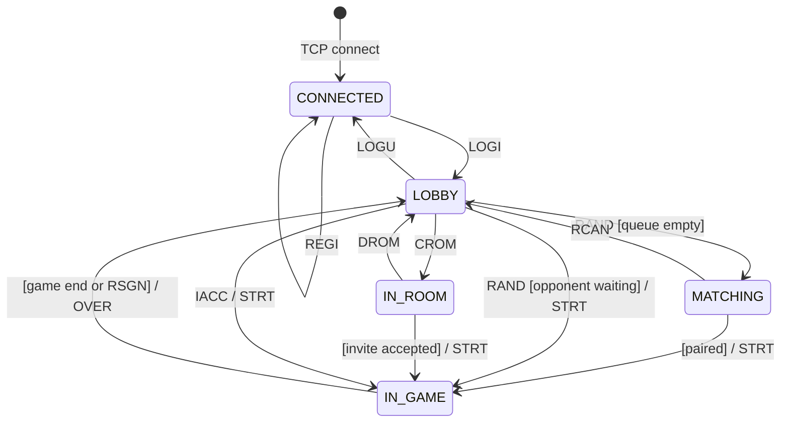

# Application Protocol — Adversarial Game Application

Version 1.5 — 15/11/2026

Tài liệu này là chuẩn chung cho server (C++) và client (JavaFX). Khi code và tài liệu khác nhau thì tài liệu đúng; muốn đổi protocol thì sửa tài liệu trước.

Nguồn: Google Doc thiết kế của nhóm và slide Design Review 1 (bản đã trình bày với cô). Message Processing Table ở Part III chép nguyên văn từ Google Doc. Những chỗ hai nguồn đó chưa nói rõ, và những chỗ bảng tự mâu thuẫn đã được chốt lại theo yêu cầu của đề tài, được gom ở [Appendix A](#appendix-a-clarifications-and-resolved-points). Bảng đối chiếu với yêu cầu và barem của đề tài ở [Appendix C](#appendix-c-requirement-coverage).

Phần đặc tả viết bằng tiếng Anh theo đúng thuật ngữ của slide và của môn học, để chép thẳng vào báo cáo được. Ghi chú cho nhóm viết bằng tiếng Việt.

| Bạn cần | Đọc |
|---|---|
| Hiểu cả hệ thống trong 5 phút | [Part I](#part-i--overview) |
| Viết bộ đọc/ghi message | [Part II](#part-ii--general-conventions) |
| Cài đặt một chức năng cụ thể | Dòng use case tương ứng trong Message Processing Table ở [Part III](#part-iii--protocol-description-by-use-case) |
| Xử lý các ca khó (disconnect, message đến chéo) | [Part IV](#part-iv--cross-cutting-rules) |

**Contents**

- [Part I — Overview](#part-i--overview): architecture, a typical session, 5 states, 20 messages, 17 status codes
- [Part II — General conventions](#part-ii--general-conventions): message format, data types, response and error rules
- [Part III — Protocol description by use case](#part-iii--protocol-description-by-use-case)
  - [Scenario 1 — Authentication](#scenario-1--authentication-regi-logi-logu): 1 Register · 2 Log in · 3 Log out
  - [Scenario 2 — Lobby information queries](#scenario-2--lobby-information-queries-plst-rank): 4 View Online Players · 5 View Player Rankings
  - [Scenario 3 — Match entry](#scenario-3--match-entry-crom-invt-iacc-idec-drom-rand-rcan): 6 Create Room · 7 Invite Player · 8 Join Room / Accept Invitation · 9 Decline Invitation · 10 Leave Room · 11 Match Randomly · 12 Cancel Matching
  - [Scenario 4 — Play game](#scenario-4--play-game-move-rsgn-over): 13 Make a Move · 14 Resign · 15 End of Game
- [Part IV — Cross-cutting rules](#part-iv--cross-cutting-rules): game rules, Elo, invitation lifecycle, disconnection, race conditions, logging
- [Appendix A](#appendix-a-clarifications-and-resolved-points): clarifications and resolved points · [Appendix B](#appendix-b-corrections-to-the-slides) · [Appendix C](#appendix-c-requirement-coverage): requirement coverage

---

# Part I — Overview

## 1. System

An online platform for two-player adversarial games: Gomoku/Caro (15×15) and Reversi (8×8). A player registers, logs in, views online players, finds an opponent by random matching or by creating a room and inviting someone, plays, and views the ranking by Elo rating.

```
 Client 1 ──┐                                    ┌──────────── SERVER ────────────┐
 Client 2 ──┼── TCP, one persistent connection ─▶│ Network & concurrency handler (I/O multiplexing)
 Client N ──┘   per client                       │ Session, room & match manager
                                                 │ Game engine: caro module, reversi module
 Thin client: UI + socket.                       │ Persistent storage: accounts, Elo ratings
 Sends requests, renders what it receives.       │ Message logger: every message sent/received
                                                 └────────────────────────────────┘
```

| Property | Choice | Consequence for implementation |
|---|---|---|
| Architecture | Client-server | Clients never connect to each other; A's move reaches B through the server |
| Transport | TCP | Reliable and ordered, but a byte stream: messages must be framed with `\r\n` |
| Connection | One persistent connection per client | The server can push events at any time (invitation, opponent's move) |
| State | Stateful | The server tracks the state of each connection; the same message may be accepted or rejected depending on state |
| Delivery | Unicast | Each message goes to one connection; "push to both" means two messages |
| Data format | Character format, one line per message | Human-readable; testable with `nc` or `telnet` |
| Authority | Server is the authoritative referee | The server stores the board, validates every move, decides the result |

## 2. A typical session

Players A and B, from login to the end of one Caro game found by random matching. Right arrow: sent by the client. Left arrow: sent by the server.

```
 A                                 Server                                 B
 │── LOGI|minh|123456 ─────────────▶│                                     │
 │◀──────────────────── LOGI|0 ─────│          A: CONNECTED → LOBBY       │
 │                                  │◀──────────────── LOGI|tuan|abc ─────│
 │                                  │── LOGI|0 ──────────────────────────▶│
 │── RAND|caro ────────────────────▶│                                     │
 │◀──────────────────── RAND|0 ─────│          A: LOBBY → MATCHING        │
 │                                  │◀──────────────────── RAND|caro ─────│
 │                                  │── RAND|0 ──────────────────────────▶│
 │◀──── STRT|caro|1|tuan|15,15 ─────│── STRT|caro|2|minh|15,15 ──────────▶│   both → IN_GAME
 │── MOVE|7,7 ─────────────────────▶│                                     │
 │◀──────────────── MOVE|0|0| ──────│── OPPM|7,7|0| ─────────────────────▶│
 │                                  │◀───────────────────── MOVE|7,8 ─────│
 │◀──────────────── OPPM|7,8|0| ────│── MOVE|0|0| ───────────────────────▶│
 │               ...                │                 ...                 │
 │── MOVE|7,11 ────────────────────▶│          A has five in a row        │
 │◀──────────────── MOVE|0|0| ──────│── OPPM|7,11|0| ────────────────────▶│
 │◀──────── OVER|WIN|+16|1016 ──────│── OVER|LOSE|-16|984 ───────────────▶│   both → LOBBY
```

Three message categories appear here:

- **Request**: sent by the client, e.g. `RAND|caro`.
- **Response**: the server's synchronous reply to that request, same message type plus a status code: `RAND|0`. Code 0 is success, 1–16 are errors.
- **Push**: sent by the server asynchronously when an event happens, with its own message type: `STRT`, `OPPM`, `OVER`.

## 3. Protocol state machine

| State | Meaning | Status shown in the player list |
|---|---|---|
| CONNECTED | TCP connection established, not authenticated | not listed |
| LOBBY | Logged in and idle | `FREE` |
| MATCHING | Waiting in a random-matching queue | `BUSY` |
| IN_ROOM | Room host waiting for an invitee to accept | `BUSY` |
| IN_GAME | Playing a game | `BUSY` |



State table (successful cases only; every error response leaves the state unchanged):

| Current state | Trigger | Precondition | Effect (sent to this connection) | Next state |
|---|---|---|---|---|
| CONNECTED | receive REGI | username is unique | `REGI\|0` | CONNECTED |
| CONNECTED | receive LOGI | valid credentials, account not active | `LOGI\|0` | LOBBY |
| LOBBY | receive LOGU | | `LOGU\|0` | CONNECTED |
| LOBBY | receive PLST, RANK | | list | LOBBY |
| LOBBY | invited by a host | | push `INVI` | LOBBY |
| LOBBY | receive IDEC | pending invitation exists | `IDEC\|0` | LOBBY |
| LOBBY | receive RAND | queue of that game is empty | `RAND\|0` | MATCHING |
| LOBBY | receive RAND | an opponent is waiting | `RAND\|0`, then push `STRT` | IN_GAME |
| LOBBY | receive CROM | | `CROM\|0\|<roomId>` | IN_ROOM |
| LOBBY | receive IACC | pending invitation exists | `IACC\|0`, then push `STRT` | IN_GAME |
| MATCHING | receive RCAN | | `RCAN\|0` | LOBBY |
| MATCHING | another player sends RAND for the same game | | push `STRT` | IN_GAME |
| IN_ROOM | receive PLST | | list | IN_ROOM |
| IN_ROOM | receive INVT | target is valid | `INVT\|0` | IN_ROOM |
| IN_ROOM | an invitation is declined or cancelled | | push `IDCL` | IN_ROOM |
| IN_ROOM | receive DROM | | `DROM\|0` | LOBBY |
| IN_ROOM | an invitee sends IACC | | push `STRT` | IN_GAME |
| IN_GAME | receive MOVE | legal move, game continues | `MOVE\|0\|...`, possibly push `SKIP` | IN_GAME |
| IN_GAME | opponent moves | game continues | push `OPPM`, possibly push `SKIP` | IN_GAME |
| IN_GAME | game ends | win, draw, resignation or disconnection | push `OVER` | LOBBY |

Requests allowed in each state (blank: the server replies with code 12):

| Request | CONNECTED | LOBBY | MATCHING | IN_ROOM | IN_GAME |
|---|:-:|:-:|:-:|:-:|:-:|
| REGI, LOGI | ✓ | | | | |
| LOGU, RANK, RAND, CROM, IACC, IDEC | | ✓ | | | |
| PLST | | ✓ | | ✓ | |
| RCAN | | | ✓ | | |
| INVT, DROM | | | | ✓ | |
| MOVE, RSGN | | | | | ✓ |

## 4. List of messages

14 requests (each has a response of the same type) and 6 pushes.

| # | Type | Stands for | Direction | Syntax | Success response | Use case no. |
|---|---|---|---|---|---|---|
| 1 | REGI | REGIster | C → S | `REGI\|<user>\|<pass>` | `REGI\|0` | 1 |
| 2 | LOGI | LOGIn | C → S | `LOGI\|<user>\|<pass>` | `LOGI\|0` | 2 |
| 3 | LOGU | LOGoUt | C → S | `LOGU` | `LOGU\|0` | 3 |
| 4 | PLST | Player LiST | C → S | `PLST` | `PLST\|0\|<user>,<status>;...` | 4 |
| 5 | RANK | RANKing | C → S | `RANK\|<game>` | `RANK\|0\|<user>,<rating>;...` | 5 |
| 6 | CROM | Create ROoM | C → S | `CROM\|<game>` | `CROM\|0\|<roomId>` | 6 |
| 7 | INVT | INViTe player | C → S | `INVT\|<user>` | `INVT\|0` | 7 |
| 8 | INVI | INVItation | S → C push | `INVI\|<roomId>\|<host>\|<game>` | | 7 |
| 9 | IACC | Invitation ACCept | C → S | `IACC\|<roomId>` | `IACC\|0` | 8 |
| 10 | IDEC | Invitation DECline | C → S | `IDEC\|<roomId>` | `IDEC\|0` | 9 |
| 11 | IDCL | Invitation DeCLined | S → C push | `IDCL\|<user>` | | 9 |
| 12 | DROM | Delete ROoM | C → S | `DROM` | `DROM\|0` | 10 |
| 13 | RAND | RANDom match | C → S | `RAND\|<game>` | `RAND\|0` | 11 |
| 14 | RCAN | Random CANcel | C → S | `RCAN` | `RCAN\|0` | 12 |
| 15 | STRT | STaRT game | S → C push | `STRT\|<game>\|<side>\|<opponent>\|<rows>,<cols>` | | 8, 11 |
| 16 | MOVE | make a MOVE | C → S | `MOVE\|<x>,<y>` | `MOVE\|0\|<k>\|<flips>` | 13 |
| 17 | OPPM | OPPonent Move | S → C push | `OPPM\|<x>,<y>\|<k>\|<flips>` | | 13 |
| 18 | SKIP | SKIP turn | S → C push | `SKIP\|<side>` | | 13 |
| 19 | RSGN | ReSiGN | C → S | `RSGN` | `RSGN\|0` | 14 |
| 20 | OVER | game OVER | S → C push | `OVER\|<result>\|<delta>\|<newRating>` | | 15 |

Every error response has the same form: `<TYPE>|<code>`, with code 1–16.

## 5. Status and error codes

| Code | Meaning | Applicable requests |
|---|---|---|
| 0 | Success (OK) | all |
| 1 | Wrong username or password (including a non-existent account) | LOGI |
| 2 | Account is already logged in on another connection | LOGI |
| 3 | Username already exists | REGI |
| 4 | Unknown game type (must be `caro` or `reversi`) | RANK, RAND, CROM |
| 5 | Target user is not online (including a non-existent username) | INVT |
| 6 | Target user is not available (not in LOBBY, status is BUSY) | INVT |
| 7 | The invitation no longer exists | IACC, IDEC |
| 8 | Target user already has a pending invitation from this room | INVT |
| 9 | Cannot invite yourself | INVT |
| 10 | Wrong number of fields (missing or extra), or unknown message type | all |
| 11 | Username or password has an invalid format (invalid characters, spaces, empty, too long) | REGI, LOGI |
| 12 | Message not allowed in the current session state | all |
| 13 | Not your turn | MOVE |
| 14 | Invalid coordinates (not two integers, or outside the board) | MOVE |
| 15 | The cell is already occupied | MOVE |
| 16 | Move violates game rules (Reversi: flanks no pieces) | MOVE |

Groups: 1–3 authentication; 4–9 lobby and room; 10–12 syntax and state; 13–16 in-game.

---

# Part II — General conventions

## 6. Message format

```
message = TYPE *( "|" field ) CRLF
TYPE    = 4 uppercase letters A-Z      ; header: fixed-length message type
field   = any characters except "|", CR, LF (may be empty)
CRLF    = "\r\n"
```

Four delimiters, from outermost to innermost:

| Delimiter | Role | Example |
|---|---|---|
| `\r\n` | End of message | every message |
| `\|` | Field delimiter | `LOGI\|minh\|123456` |
| `;` | List item delimiter, inside one field | `minh,FREE;tuan,BUSY` |
| `,` | Sub-field delimiter, inside one list item | `minh,FREE`, coordinates `3,4` |

Rules:

1. **Framing**: one `recv` may return half a message or several messages. The receiver appends bytes to a buffer and processes a message only when it finds `\r\n`.
2. **No escaping**: a field value cannot contain a delimiter. This is why usernames and passwords have a restricted character set.
3. **Case-sensitive**: message types are uppercase (`logi` is an unknown type). Usernames, passwords and game names are case-sensitive too.
4. **Field count**: the number of fields equals the number of `|`. An empty field still counts: `LOGU|` has 1 field, `MOVE|0|0|` has 3 fields. One exception in the processing tables: for the `MOVE` request the "two fields" are `<x>` and `<y>` (Appendix A, A7).
5. **Empty line**: the server ignores it and sends no response.
6. **Oversized line**: if a client sends more than 4096 bytes without `\r\n`, the server closes the connection. Server messages have no such limit (a `RANK` response can be long).
7. **Unknown message**: a client that receives a type not defined here ignores it.

## 7. Data types

| Notation | Definition | Example |
|---|---|---|
| `<user>` | 1–32 characters from `A–Z`, `a–z`, `0–9`, `_` | `minh`, `vu_le01` |
| `<pass>` | 1–64 printable ASCII characters without spaces (0x21–0x7E). Cannot contain `\|`. | `123456` |
| `<game>` | `caro` or `reversi`, lowercase | `caro` |
| `<code>` | Integer 0–16 | `0`, `12` |
| `<status>` | `FREE` or `BUSY` | `FREE` |
| `<roomId>` | Positive integer assigned by the server, increasing from 1, never reused during one server run | `7` |
| `<side>` | `1` or `2`. Side 1 moves first. Caro: 1 is X, 2 is O. Reversi: 1 is Black, 2 is White. | `1` |
| `<x>,<y>` | Cell coordinates: `x` is the row, `y` is the column, both 0-based; `0,0` is the top-left cell | `3,4` |
| `<rows>,<cols>` | Board size: `15,15` (caro) or `8,8` (reversi) | `15,15` |
| `<k>` | Number of pieces flipped by the move. Always 0 in Caro. | `0`, `3` |
| `<flips>` | Exactly `k` coordinates separated by `;`. Empty when `k = 0`. Does not include the cell just played. | `2,4;2,5` |
| `<result>` | `WIN`, `LOSE` or `DRAW`, from the receiver's point of view | `WIN` |
| `<delta>` | Elo change of the receiver: `+16`, `-16`, or `0` | `+16` |
| `<rating>`, `<newRating>` | Elo rating, integer. `<newRating>` is the rating after the game just played. | `1016` |

## 8. Response and error rules

**For every request the server guarantees:**

1. Exactly one response, with the same message type as the request.
2. Responses are sent in the order of the requests on the same connection.
3. The response is sent before any push caused by that same request (the sender of `RAND` receives `RAND|0` before `STRT`).
4. A push caused by another player may arrive at any time, even between a request and its response.

**Order of checks, common to all requests.** Only the first failing check is reported:

1. Log the received message.
2. Message type is not one of the 14 requests: reply `<received type>|10`.
3. Current state does not allow this request: code 12.
4. Wrong number of fields: code 10.
5. Request-specific checks, in the order given in the use case.

**When the code is not 0:** the server changes nothing, the state is unchanged, and nothing is pushed to anyone.

**Client:** keep at most one request waiting for a response at a time. The reader thread looks at the first 4 characters: `INVI`, `IDCL`, `STRT`, `OPPM`, `SKIP`, `OVER` are pushes; anything else is the response to the waiting request.

---

# Part III — Protocol description by use case

Các **Message Processing Table** dưới đây chép nguyên văn từ Google Doc của nhóm: kịch bản 1 và 2 từ tab của Minh, kịch bản 3 và 4 từ tab của Vũ Lê. Cột, thứ tự use case (1–15) và câu chữ giữ nguyên, trừ 9 câu được sửa theo các quyết định R1, R2, R4 và 20 câu về ghi log được thêm theo R3, tất cả ở [Appendix A, phần B](#b-resolved-points); phần đó ghi rõ từng câu trước và sau khi sửa để nhóm cập nhật lại Google Doc. Ngoài ra có ba thay đổi về trình bày, không đổi nghĩa:

- Message và placeholder được đặt trong định dạng code để Markdown hiển thị đúng dấu `|` và `<...>`.
- Bỏ một dấu `]` thừa do gõ nhầm trong dòng `MOVE|0|<k>|...` của use case 13.
- Mỗi kịch bản có thêm phần Messages, Message flow (bản chữ của sequence diagram trên slide) và Example ở ngoài bảng.

Ghi chú khi đọc: "creator" trong bảng của kịch bản 3 chính là "host" trên slide (chủ phòng). Những điểm tài liệu này làm rõ thêm **không nằm trong bảng**; chúng ở [Appendix A](#appendix-a-clarifications-and-resolved-points), và cuối mỗi kịch bản có dòng trỏ tới các mục liên quan.

## Scenario 1 — Authentication (REGI, LOGI, LOGU)

**Messages**

```
C → S   REGI|<username>|<password>        S → C   REGI|<code>
C → S   LOGI|<username>|<password>        S → C   LOGI|<code>
C → S   LOGU                              S → C   LOGU|<code>
```

**Message flow**

```
 Client                                        Server
   │── REGI|<username>|<password> ──────────────▶│
   │◀────────────────────────────── REGI|0 ──────│   [Username available]
   │◀────────────────────────────── REGI|3 ──────│   [Username already exists]

   │── LOGI|<username>|<password> ──────────────▶│
   │◀────────────────────────────── LOGI|0 ──────│   [Valid credentials & not logged in]
   │◀────────────────────────────── LOGI|1 ──────│   [Wrong username or password]
   │◀────────────────────────────── LOGI|2 ──────│   [Already logged in on another connection]

   │── LOGU ────────────────────────────────────▶│
   │◀────────────────────────────── LOGU|0 ──────│   [Client is in LOBBY]
   │◀────────────────────────────── LOGU|12 ─────│   [Not in LOBBY (in room, game)]
```

**Message Processing Table — Scenario 1**

| Use Case | Client Side Processing | Server Side Processing |
|---|---|---|
| 1. Register (REGI) | - Precondition: State is CONNECTED.<br>- Validate input locally, then send:<br>`REGI\|<username>\|<password>\r\n`<br>- Wait for response:<br>&nbsp;&nbsp;+ If `REGI\|0`: Display registration success, prompt user to log in (stay in CONNECTED).<br>&nbsp;&nbsp;+ If `REGI\|3`, 10, 11, 12: Display corresponding error message.<br>- Log received message. | - Log received message.<br>- Verify connection state is CONNECTED (if not, reply `REGI\|12`).<br>- Check field count and characters (if invalid, reply `REGI\|10` or `REGI\|11`).<br>- Check database if `<username>` exists:<br>&nbsp;&nbsp;+ If exists: Reply `REGI\|3\r\n`.<br>&nbsp;&nbsp;+ If unique: Create account with initial Elo = 1000 for caro and reversi, save to storage, and reply `REGI\|0\r\n`.<br>- Log every message sent (response and pushes). |
| 2. Log in (LOGI) | - Precondition: State is CONNECTED.<br>- Send credentials:<br>`LOGI\|<username>\|<password>\r\n`<br>- Wait for response:<br>&nbsp;&nbsp;+ If `LOGI\|0`: Transition UI to Lobby (LOBBY).<br>&nbsp;&nbsp;+ If `LOGI\|1` (wrong credentials) or `LOGI\|2` (already logged in): Display error.<br>- Log received message. | - Log received message.<br>- Verify state is CONNECTED (else reply `LOGI\|12`) and check syntax (10, 11).<br>- Verify `<username>` and `<password>` against storage:<br>&nbsp;&nbsp;+ If mismatch or non-existent: Reply `LOGI\|1\r\n`.<br>&nbsp;&nbsp;+ If account is already active on another socket: Reply `LOGI\|2\r\n`.<br>&nbsp;&nbsp;+ If valid: Bind socket to account, set state to LOBBY (status = FREE), and reply `LOGI\|0\r\n`.<br>- Log every message sent (response and pushes). |
| 3. Log out (LOGU) | - Precondition: State is LOBBY.<br>- Send request: `LOGU\r\n`<br>- On receiving `LOGU\|0`: Return UI to Login screen (state CONNECTED) while keeping TCP socket open.<br>- Log received message. | - Log received message.<br>- Verify state is LOBBY (if in room/queue/game, reply `LOGU\|12`; if extra fields, reply `LOGU\|10`).<br>- Unbind account from connection, mark user offline, transition socket state to CONNECTED, and reply `LOGU\|0\r\n`.<br>- Log every message sent (response and pushes). |

**Example**

```
C: REGI|minh|123456        S: REGI|0
C: REGI|minh|abcdef        S: REGI|3
C: REGI|hoang minh|123     S: REGI|11
C: REGI|minh               S: REGI|10
C: LOGI|minh|wrong         S: LOGI|1
C: LOGI|minh|123456        S: LOGI|0
C: LOGI|minh|123456        S: LOGI|12       (already logged in)
C: LOGU                    S: LOGU|0
C: LOGU                    S: LOGU|12       (state is CONNECTED)
```

Xem thêm Appendix A: A1 (ký tự hợp lệ của username và password), A2 (message type lạ), và use case 9 (khi `LOGU` thành công, các lời mời đang chờ gửi tới người này bị hủy và host nhận `IDCL`).

## Scenario 2 — Lobby information queries (PLST, RANK)

**Messages**

```
C → S   PLST               S → C   PLST|0|<user1>,<status1>;...;<usern>,<statusn>      or   PLST|<code>
C → S   RANK|<game>        S → C   RANK|0|<user1>,<rating1>;...;<usern>,<ratingn>      or   RANK|<code>
```

**Message flow**

```
 Client                                        Server
   │── PLST ────────────────────────────────────▶│
   │◀─ PLST|0|<user1>,<status1>;...;<usern>,<statusn> ─│   [Client is in LOBBY or IN_ROOM]
   │◀──────────────────────────── PLST|12 ───────│   [Invalid state (e.g., IN_GAME)]

   │── RANK|<game> ─────────────────────────────▶│
   │◀─ RANK|0|<user1>,<rating1>;...;<usern>,<ratingn> ─│   [Valid game type (caro or reversi)]
   │◀──────────────────────────── RANK|4 ────────│   [Unknown game type]
```

**Message Processing Table — Scenario 2**

| Use Case | Client Side Processing | Server Side Processing |
|---|---|---|
| 4. View Online Players (PLST) | - Precondition: State is LOBBY or IN_ROOM.<br>- Send request: `PLST\r\n`<br>- On receiving `PLST\|0\|<u1>,<s1>;...`: Parse list by `;` and `,`, and render online players with their availability (FREE / BUSY).<br>- Log received message. | - Log received message.<br>- Verify state is LOBBY or IN_ROOM (else reply `PLST\|12`) and no extra parameters exist (else reply `PLST\|10`).<br>- Iterate through active sessions: mark FREE if in LOBBY, or BUSY if in MATCHING, IN_ROOM, or IN_GAME.<br>- Reply `PLST\|0\|<user1>,<status1>;...;<usern>,<statusn>\r\n` (state remains unchanged).<br>- Log every message sent (response and pushes). |
| 5. View Player Rankings (RANK) | - Precondition: State is LOBBY.<br>- Send request for selected game:<br>`RANK\|<game>\r\n` (caro or reversi)<br>- On receiving `RANK\|0\|<u1>,<r1>;...`: Parse list and display leaderboard sorted by Elo rating.<br>- Log received message. | - Log received message.<br>- Verify state is LOBBY (else reply `RANK\|12`) and field count is valid (else reply `RANK\|10`).<br>- Validate `<game>` is caro or reversi (if unknown, reply `RANK\|4\r\n`).<br>- Fetch all accounts, sort by Elo rating for `<game>` in descending order, and reply:<br>`RANK\|0\|<user1>,<rating1>;...;<usern>,<ratingn>\r\n`.<br>- Log every message sent (response and pushes). |

**Example**

```
C: PLST                    S: PLST|0|linh,BUSY;minh,FREE;tuan,FREE
C: RANK|caro               S: RANK|0|minh,1050;linh,1000;tuan,950
C: RANK|chess              S: RANK|4
```

Xem thêm Appendix A: A4 (`PLST` gồm cả người gửi, xếp theo username), A5 (thứ tự khi bằng điểm trong `RANK`).

## Scenario 3 — Match entry (CROM, INVT, IACC, IDEC, DROM, RAND, RCAN)

**Messages**

```
C → S   CROM|<game>         S → C   CROM|0|<roomId>     or   CROM|<code>
C → S   INVT|<username>     S → C   INVT|<code>
C → S   IACC|<roomId>       S → C   IACC|<code>
C → S   IDEC|<roomId>       S → C   IDEC|<code>
C → S   DROM                S → C   DROM|<code>
C → S   RAND|<game>         S → C   RAND|<code>
C → S   RCAN                S → C   RCAN|<code>

Push    INVI|<roomId>|<creator>|<game>                    to the invitee
Push    IDCL|<user>                                       to the creator
Push    STRT|<game>|<side>|<opponent>|<rows>,<cols>       to both players
```

**Message flow**

```
 Client A                          Server                        Client B
 ─── alt [Invite a friend] ────────────────────────────────────────────────
   │── CROM|<game> ─────────────────▶│
   │◀──────── CROM|0|<roomId> ───────│
   │── INVT|<username> ─────────────▶│
   │◀──────────────── INVT|0 ────────│── INVI|<roomId>|<creator>|<game> ─▶│
   │     ─── break ───               │
   │                                 │◀───────────── IDEC|<roomId> ────│
   │◀──────────── IDCL|<user> ───────│── IDEC|0 ──────────────────────▶│
   │     ─────────────               │
   │                                 │◀───────────── IACC|<roomId> ────│
   │                                 │── IACC|0 ──────────────────────▶│
 ─── [Random match] ───────────────────────────────────────────────────────
   │── RAND|<game> ─────────────────▶│
   │◀──────────────── RAND|0 ────────│
   │                                 │◀─────────────── RAND|<game> ────│
   │                                 │── RAND|0 ──────────────────────▶│
 ──────────────────────────────────────────────────────────────────────────
   │◀─ STRT|<game>|<side>|<opponent>|<rows>,<cols> ─│─ STRT|<game>|<side>|<opponent>|<rows>,<cols> ─▶│
```

**Message Processing Table — Scenario 3**

| Use Case | Client Side Processing | Server Side Processing |
|---|---|---|
| 6. Create Room (CROM) | - Precondition: State is LOBBY.<br>- Send request for selected game: `CROM\|<game>\r\n` (caro or reversi)<br>- On receiving `CROM\|0\|<roomId>`: store roomId, change state to IN_ROOM, show the room screen, and send PLST to list players to invite.<br>- On receiving `CROM\|4`, `CROM\|10` or `CROM\|12`: show the error and stay in LOBBY.<br>- Log received message. | - Log received message.<br>- Verify state is LOBBY (else reply `CROM\|12`) and field count is valid (else reply `CROM\|10`).<br>- Validate `<game>` is caro or reversi (if unknown, reply `CROM\|4\r\n`).<br>- Create a room with a new roomId, the game, and owner = this player. Set the player's state to IN_ROOM.<br>- Reply `CROM\|0\|<roomId>\r\n`.<br>- Log every message sent (response and pushes). |
| 7. Invite Player (INVT) | - Precondition: State is IN_ROOM.<br>- Send request for the chosen player: `INVT\|<username>\r\n`<br>- On receiving `INVT\|0`: add the player to the invited list as "waiting". The creator may invite more players.<br>- On receiving `INVT\|5` or `INVT\|6`: show the reason and send PLST to refresh the list. On `INVT\|8`: show that the player was already invited. On `INVT\|9`, `INVT\|10` or `INVT\|12`: show the error.<br>- Invitee side: on receiving push `INVI\|<roomId>\|<creator>\|<game>`, add the invitation to the pending list and display it. State stays LOBBY.<br>- Creator side: on receiving push `IDCL\|<user>`, remove `<user>` from the invited list. The creator may invite someone else.<br>- Log received message. | - Log received message.<br>- Verify state is IN_ROOM (else reply `INVT\|12`) and exactly one field exists (else reply `INVT\|10`).<br>- Check in order: target is not the sender (else `INVT\|9`), target is online (else `INVT\|5`), the room has no pending invitation to the target (else `INVT\|8`), target state is LOBBY (else `INVT\|6`).<br>- Record the invitation in the room.<br>- Reply `INVT\|0\r\n` to the creator and push `INVI\|<roomId>\|<creator>\|<game>\r\n` to the target (target state unchanged).<br>- Log every message sent (response and pushes). |
| 8. Join Room / Accept Invitation (IACC) | - Precondition: State is LOBBY and the invitation exists in the pending list.<br>- Send request: `IACC\|<roomId>\r\n`<br>- On receiving `IACC\|0`: show a transition state ("joining game") and wait for STRT.<br>- On receiving `IACC\|7`: remove the invitation from the list and show "invitation no longer valid".<br>- On receiving `IACC\|10` or `IACC\|12`: show the error.<br>- Both players: on receiving push `STRT\|<game>\|<side>\|<opponent>\|<rows>,<cols>`, store side and board size, draw the board, and change state to IN_GAME. For the creator, `<opponent>` names the player whose invitation was accepted.<br>- Log received message. | - Log received message.<br>- Verify state is LOBBY (else reply `IACC\|12`) and exactly one field exists (else reply `IACC\|10`).<br>- Verify the player has a pending invitation from room `<roomId>` (else reply `IACC\|7`).<br>- As one atomic step: create the game with the game module, remove all invitations of this room (their invitees are not notified), remove each other pending invitation of the invitee and push `IDCL\|<invitee>\r\n` to its creator, and set both players to IN_GAME.<br>- Reply `IACC\|0\r\n` to the invitee, then push `STRT\|<game>\|1\|<invitee>\|<rows>,<cols>\r\n` to the creator and `STRT\|<game>\|2\|<creator>\|<rows>,<cols>\r\n` to the invitee.<br>- Log every message sent (response and pushes). |
| 9. Decline Invitation (IDEC) | - Precondition: State is LOBBY and the invitation exists in the pending list.<br>- Send request: `IDEC\|<roomId>\r\n`<br>- On receiving `IDEC\|0`: remove the invitation from the list.<br>- On receiving `IDEC\|7`: remove it too and show "invitation no longer valid".<br>- On receiving `IDEC\|10` or `IDEC\|12`: show the error.<br>- Log received message. | - Log received message.<br>- Verify state is LOBBY (else reply `IDEC\|12`) and exactly one field exists (else reply `IDEC\|10`).<br>- Verify the player has a pending invitation from room `<roomId>` (else reply `IDEC\|7`).<br>- Remove the invitation. Reply `IDEC\|0\r\n` and push `IDCL\|<invitee>\r\n` to the creator (the creator stays in IN_ROOM).<br>- IDCL is also pushed when the invitee accepts another invitation or leaves LOBBY without answering (RAND, CROM, logout, disconnect).<br>- Log every message sent (response and pushes). |
| 10. Leave Room (DROM) | - Precondition: State is IN_ROOM.<br>- Send request: `DROM\r\n`<br>- On receiving `DROM\|0`: change state to LOBBY and show the lobby.<br>- On receiving `DROM\|12`: an invitee has just accepted, so handle the STRT that follows and do not show an error.<br>- On receiving `DROM\|10`: show the error.<br>- Log received message. | - Log received message.<br>- Verify state is IN_ROOM (else reply `DROM\|12`) and no extra parameters exist (else reply `DROM\|10`).<br>- Delete the room together with all its pending invitations. Invitees are not notified. Their later IACC or IDEC gets code 7.<br>- Set the creator's state to LOBBY and reply `DROM\|0\r\n`.<br>- If the creator disconnects in IN_ROOM, do the same without a reply.<br>- Log every message sent (response and pushes). |
| 11. Match Randomly (RAND) | - Precondition: State is LOBBY.<br>- Send request for selected game: `RAND\|<game>\r\n` (caro or reversi)<br>- On receiving `RAND\|0`: change state to MATCHING, show "searching for an opponent" and a cancel button. This only means the request was accepted.<br>- On receiving `RAND\|4`, `RAND\|10` or `RAND\|12`: show the error and stay in LOBBY.<br>- On receiving push `STRT\|<game>\|<side>\|<opponent>\|<rows>,<cols>`: store side and board size, draw the board, and change state to IN_GAME.<br>- Log received message. | - Log received message.<br>- Verify state is LOBBY (else reply `RAND\|12`) and exactly one field exists (else reply `RAND\|10`).<br>- Validate `<game>` is caro or reversi (if unknown, reply `RAND\|4\r\n`).<br>- If the queue of `<game>` is empty, append the player, set state to MATCHING, and reply `RAND\|0\r\n`.<br>- Otherwise remove the first waiting player, create the game, set both players to IN_GAME, reply `RAND\|0\r\n` to the requester, then push `STRT\|<game>\|1\|<requester>\|<rows>,<cols>\r\n` to the player who waited and `STRT\|<game>\|2\|<waiting player>\|<rows>,<cols>\r\n` to the requester.<br>- Log every message sent (response and pushes). |
| 12. Cancel Matching (RCAN) | - Precondition: State is MATCHING.<br>- Send request: `RCAN\r\n`<br>- On receiving `RCAN\|0`: change state to LOBBY.<br>- On receiving `RCAN\|12`: the pairing already happened, so handle the STRT that follows and do not show an error.<br>- On receiving `RCAN\|10`: show the error.<br>- Log received message. | - Log received message.<br>- Verify state is MATCHING (else reply `RCAN\|12`) and no extra parameters exist (else reply `RCAN\|10`).<br>- Remove the player from the queue, set state to LOBBY, and reply `RCAN\|0\r\n`.<br>- If the player disconnects in MATCHING, remove them from the queue without a reply.<br>- Log every message sent (response and pushes). |

**Example** (minh creates room 7 for caro; tuan declines; linh accepts)

```
minh: CROM|caro     S→minh: CROM|0|7
minh: INVT|minh     S→minh: INVT|9
minh: INVT|nobody   S→minh: INVT|5
minh: INVT|tuan     S→minh: INVT|0        S→tuan: INVI|7|minh|caro
minh: INVT|tuan     S→minh: INVT|8
tuan: IDEC|7        S→tuan: IDEC|0        S→minh: IDCL|tuan
tuan: IDEC|7        S→tuan: IDEC|7
minh: INVT|linh     S→minh: INVT|0        S→linh: INVI|7|minh|caro
linh: IACC|7        S→linh: IACC|0
                    S→minh: STRT|caro|1|linh|15,15
                    S→linh: STRT|caro|2|minh|15,15
```

**Example** (random matching)

```
minh: RAND|caro     S→minh: RAND|0                    (queue empty, minh waits)
tuan: RAND|caro     S→tuan: RAND|0
                    S→minh: STRT|caro|1|tuan|15,15    (the player who waited is side 1)
                    S→tuan: STRT|caro|2|minh|15,15
linh: RAND|reversi  S→linh: RAND|0                    (reversi queue empty, linh waits)
linh: RCAN          S→linh: RCAN|0
```

Xem thêm Appendix A: A6 (dạng của `roomId`), và các điểm đã chốt R1 (bỏ chữ "lock"), R2 (`DROM|12`), R3 (ghi log), R5 (lúc nào xóa phòng).

## Scenario 4 — Play game (MOVE, RSGN, OVER)

**Messages**

```
C → S   MOVE|<x>,<y>        S → C   MOVE|0|<k>|<x1>,<y1>;...;<xk>,<yk>     or   MOVE|<code>
C → S   RSGN                S → C   RSGN|<code>

Push    OPPM|<x>,<y>|<k>|<x1>,<y1>;...;<xk>,<yk>          to the opponent
Push    SKIP|<side>                                       to both players (reversi only)
Push    OVER|<result>|<delta>|<newRating>                 to both players
```

**Message flow**

```
 Client A                          Server                        Client B
 ─── loop [Game not over] ─────────────────────────────────────────────────
   │── MOVE|<x>,<y> ────────────────▶│   Check rules, update board
   │   ─── alt [valid] ───           │
   │◀─ MOVE|0|<k>|<x1>,<y1>;...;<xk>,<yk> ─│─ OPPM|<x>,<y>|<k>|<x1>,<y1>;...;<xk>,<yk> ─▶│
   │       ─── break [no legal move] ───
   │◀──────────── SKIP|<side> ───────│── SKIP|<side> ─────────────────▶│
   │   ─── [invalid] ───             │
   │◀──────────── MOVE|<code> ───────│
   │                                 │◀──────────────── MOVE|<x>,<y> ──│
 ──────────────────────────────────────────────────────────────────────────
   │◀─ OVER|<result>|<delta>|<newRating> ─│─ OVER|<result>|<delta>|<newRating> ─▶│
```

**Message Processing Table — Scenario 4**

| Use Case | Client Side Processing | Server Side Processing |
|---|---|---|
| 13. Make a Move (MOVE) | - Precondition: State is IN_GAME and it is the player's turn (side 1 moves first).<br>- Send request: `MOVE\|<x>,<y>\r\n` (row x, column y, both 0-based). Block further input until the response arrives.<br>- On receiving `MOVE\|0\|<k>\|<x1>,<y1>;...;<xk>,<yk>`: place the player's piece at (x, y), apply the k changed cells (flipped pieces in reversi, k = 0 in caro), and pass the turn to the opponent.<br>- On receiving `MOVE\|13`, `MOVE\|14`, `MOVE\|15` or `MOVE\|16`: show the reason (not your turn, invalid coordinates, cell occupied, move not allowed by the rules) and keep the turn so the player can try again. On `MOVE\|10`: show the error. On `MOVE\|12`: the game has just ended, so handle the OVER and do not show an error.<br>- Opponent side: on receiving push `OPPM\|<x>,<y>\|<k>\|<x1>,<y1>;...;<xk>,<yk>`, place the opponent's piece, apply the changed cells, and take the turn.<br>- On receiving push `SKIP\|<side>` (reversi only): show that the turn of `<side>` was skipped. The player who had just moved moves again.<br>- Log received message. | - Log received message.<br>- Verify state is IN_GAME (else reply `MOVE\|12`) and exactly two fields exist (else reply `MOVE\|10`).<br>- Check in order: it is this player's turn (else `MOVE\|13`), x and y are integers inside the board (else `MOVE\|14`), the cell is empty (else `MOVE\|15`), the game module accepts the move (else `MOVE\|16`). Only the first failing check is reported.<br>- Apply the move with the game module, which returns the changed cells, and pass the turn.<br>- Reply `MOVE\|0\|<k>\|<x1>,<y1>;...;<xk>,<yk>\r\n` to the mover and push `OPPM\|<x>,<y>\|<k>\|<x1>,<y1>;...;<xk>,<yk>\r\n` to the opponent.<br>- Ask the game module for the result. If the game ended (win, draw, or neither player can move), run End of Game (15). Otherwise, if the player who now has the turn has no legal move (reversi), push `SKIP\|<side>\r\n` to both players and give the turn back.<br>- Log every message sent (response and pushes). |
| 14. Resign (RSGN) | - Precondition: State is IN_GAME.<br>- Send request when the player gives up or leaves the game for the lobby: `RSGN\r\n`<br>- On receiving `RSGN\|0`: wait for the OVER push.<br>- On receiving `RSGN\|10`: show the error.<br>- On receiving `RSGN\|12`: the game has just ended, so handle the OVER and do not show an error.<br>- Log received message. | - Log received message.<br>- Verify state is IN_GAME (else reply `RSGN\|12`) and no extra parameters exist (else reply `RSGN\|10`).<br>- Reply `RSGN\|0\r\n` and end the game with the sender as the loser (End of Game, 15).<br>- If a player's connection closes in IN_GAME, do the same without sending a reply.<br>- Log every message sent (response and pushes). |
| 15. End of Game (OVER) | - Triggered by a server push, not by a request.<br>- On receiving `OVER\|<result>\|<delta>\|<newRating>`: stop the game, show the result (WIN, LOSE or DRAW from the player's point of view) with the rating change and the new rating, then change state to LOBBY.<br>- A `MOVE\|12` or `RSGN\|12` received just before OVER is a normal race, not a fault.<br>- Log received message. | - Triggered by: a winning or drawing move, no legal move for both players (reversi), RSGN, or a disconnection.<br>- Mark the game as ended, so any later MOVE or RSGN gets code 12.<br>- Decide the result: from the game module for a win or draw, or the resigning or disconnected player loses.<br>- Update Elo for this game: E_A = 1 / (1 + 10^((R_B - R_A) / 400)), S_A = 1 (win), 0.5 (draw) or 0 (loss), delta_A = round(32 * (S_A - E_A)), R_A = R_A + delta_A, R_B = R_B - delta_A. Store the ratings persistently.<br>- Set both players to LOBBY and delete the game and its room.<br>- Push `OVER\|<result>\|<delta>\|<newRating>\r\n` to each connected player. A disconnected player gets nothing.<br>- Log every message sent (response and pushes). |

**Example, Caro** (A is side 1, B is side 2, both rated 1000)

```
B: MOVE|7,7         S→B: MOVE|13
A: MOVE|7,7         S→A: MOVE|0|0|        S→B: OPPM|7,7|0|
B: MOVE|7,7         S→B: MOVE|15
B: MOVE|7,20        S→B: MOVE|14
B: MOVE|8,7         S→B: MOVE|0|0|        S→A: OPPM|8,7|0|
  ...
A: MOVE|7,11        S→A: MOVE|0|0|        S→B: OPPM|7,11|0|      (A has five in a row)
                    S→A: OVER|WIN|+16|1016
                    S→B: OVER|LOSE|-16|984
```

**Example, Reversi** (initial position, A is side 1, both rated 1000)

```
A: MOVE|0,0         S→A: MOVE|16
A: MOVE|2,3         S→A: MOVE|0|1|3,3     S→B: OPPM|2,3|1|3,3
  ... later, A plays a move that leaves B with no legal move:
A: MOVE|5,6         S→A: MOVE|0|2|5,5;4,6   S→B: OPPM|5,6|2|5,5;4,6
                    S→A: SKIP|2             S→B: SKIP|2          (A moves again)
B: RSGN             S→B: RSGN|0
                    S→B: OVER|LOSE|-16|984
                    S→A: OVER|WIN|+16|1016
```

Xem thêm Appendix A: A7 ("exactly two fields" của MOVE), A8 (`MOVE|0|0|` khi `k = 0`), A9 (dạng của `<delta>`), A10 (Elo: ai là A, làm tròn), và các điểm đã chốt R1 (bỏ chữ "lock"), R4 (`MOVE|12`, `RSGN|12`).

---

# Part IV — Cross-cutting rules

## 9. Game rules

The protocol never sends the whole board. The client builds the board from `STRT`, `MOVE` and `OPPM`, so it must know the initial position and how to track the turn.

**Caro (`caro`)**

- Board 15×15, initially empty. Side 1 (X) moves first; players alternate.
- Each turn places one piece on an empty cell.
- A player wins by forming a line of five or more of their own pieces, horizontally, vertically or diagonally. The blocked-ends rule is not applied.
- Draw when the board is full (225 pieces) and no one has won.
- No `SKIP`; code 16 never occurs.

**Reversi (`reversi`)**

- Board 8×8. Side 1 (Black) moves first.
- Initial position (digits are `<side>`, dots are empty cells):

```
        y = 0 1 2 3 4 5 6 7
x = 3       . . . 2 1 . . .
x = 4       . . . 1 2 . . .
```

- Legal move: place a piece on an empty cell so that, in at least one of the 8 directions, a contiguous line of opponent pieces is flanked between the new piece and another piece of the mover. All flanked pieces in all directions are flipped.
- A player with no legal move is skipped; the server detects this and pushes `SKIP`.
- The game ends when neither player has a legal move (a full board is one such case). The side with more pieces wins; equal counts is a draw.

**Turn tracking on the client**

| Event | The turn then belongs to |
|---|---|
| Receive `STRT` | side 1 |
| Receive `MOVE\|0\|...` | the opponent |
| Receive `OPPM` | me |
| Receive `SKIP\|<side>` | the side that is not `<side>` |

## 10. Elo rating

- Every account has two separate ratings, one for `caro` and one for `reversi`, both starting at 1000. A game changes only the rating of the game just played.
- Let A be side 1 and B be side 2; `R_A`, `R_B` are the ratings before the game.

```
E_A   = 1 / (1 + 10^((R_B − R_A) / 400))      expected score of A
S_A   = 1 if A wins, 0.5 for a draw, 0 if A loses
Δ     = round(32 × (S_A − E_A))               nearest integer; .5 rounds away from zero
R_A'  = R_A + Δ
R_B'  = R_B − Δ
```

- The two players always receive opposite changes, so the sum of ratings does not change. `<delta>` in `OVER` is `Δ` for A and `−Δ` for B.
- A resignation or a disconnection is scored as a normal loss.
- The leaderboard (use case 5) is sorted by rating descending, ties by username ascending.

## 11. Invitation lifecycle

An invitation is identified by the pair (room, invitee). It is created by a successful `INVT` and exists only while the room exists and the invitee is in LOBBY.

| The invitation ends because | Host is notified by | Invitee is notified by |
|---|---|---|
| Invitee sends `IACC` | push `STRT` | `IACC\|0`, then push `STRT` |
| Invitee sends `IDEC` | push `IDCL` | `IDEC\|0` |
| Invitee leaves LOBBY: `RAND`, `CROM`, `LOGU`, accepts another room, disconnects | push `IDCL` | not needed |
| Host sends `DROM` or disconnects | not needed | **not notified**; later `IACC`/`IDEC` gets code 7 |
| Another invitee of the same room sent `IACC` first | push `STRT` | **not notified**; later `IACC`/`IDEC` gets code 7 |

Because of the two "not notified" cases, the invitation list on a client may contain dead invitations. The client treats code 7 as normal.

## 12. Disconnection

The server considers a connection closed when `recv` returns 0 or an error. A disconnected player receives no response and no push.

| State at disconnection | Server action | Who is notified |
|---|---|---|
| CONNECTED | Nothing | nobody |
| LOBBY | Mark offline; remove pending invitations addressed to this player | those hosts, by `IDCL` |
| MATCHING | Remove from the queue; mark offline | nobody |
| IN_ROOM | Delete the room and its invitations; mark offline | nobody (invitees will get code 7) |
| IN_GAME | Run End of Game (use case 15) with this player as the loser; then mark offline | the opponent, by `OVER\|WIN\|...` |

The protocol has no heartbeat, no time limit per move, and no reconnection into a running game. A client that loses its connection reconnects and sends `LOGI` again.

## 13. Race conditions

A request from one client and an event caused by another client can cross on the wire. The cases below are normal; the client **does not show an error**:

| Client just sent | Receives | It means | Client action |
|---|---|---|---|
| `RCAN` | `RCAN\|12` | Paired before the cancel reached the server | Enter the game on `STRT` |
| `DROM` | `DROM\|12` | An invitee accepted before the request reached the server | Enter the game on `STRT` |
| `MOVE` | `MOVE\|12` | The game has just ended (opponent resigned or disconnected) | Handle `OVER` |
| `RSGN` | `RSGN\|12` | The game has just ended | Handle `OVER` |
| `IACC`, `IDEC` | code 7 | The host left the room, or another invitee accepted first | Remove the invitation |
| `INVT` | code 5 or 6 | The target just went offline or became busy | Send `PLST` again |

The related push (`STRT`, `OVER`) may arrive before or after the code-12 response; the client must handle both orders. A simple approach: always process a push as soon as it arrives, and ignore a code-12 response if the client's state has already changed since the request was sent.

## 14. Server logging

The server logs **every message received and every message sent**, to a log file and to the terminal. This is a graded requirement of the topic ("Log received and sent messages on the server"). In the processing tables this is the first step ("Log received message.") and the last step ("Log every message sent (response and pushes).") of every Server cell; sent lines carry the label `SEND`.

The client prints every message it sends and receives to its terminal, in all 15 use cases. This is not graded; it is for debugging and for the demo.

Server log format: Each line has a timestamp, the connection id, a label, and the message as is (without `\r\n`):

```
2026-11-14 21:03:07.123 [conn 5] CONNECT 192.168.1.20:51844
2026-11-14 21:03:09.481 [conn 5] RECV LOGI|minh|123456
2026-11-14 21:03:09.482 [conn 5] SEND LOGI|0
2026-11-14 21:07:55.010 [conn 5] CLOSE
```

| Label | Logged when |
|---|---|
| `CONNECT` | A new connection is accepted, with the client address |
| `RECV` | A complete line is received from a client; logged before processing, even if it will be rejected |
| `SEND` | A line is sent to a client, response or push |
| `CLOSE` | The connection is closed |

---

## Appendix A: Clarifications and resolved points

### A. Clarifications

Google Doc và slide chưa nói rõ các điểm dưới đây. Tài liệu này đã chọn một cách và ghi ở đây, **không sửa vào Message Processing Table**. Ai không đồng ý thì nêu ra để sửa trước khi code.

| # | Question | Decision | Use case |
|---|---|---|---|
| A1 | Valid characters of username and password (code 11) | Username: 1–32 letters, digits, `_`. Password: 1–64 printable ASCII, no spaces. | 1, 2 |
| A2 | Unknown message type | Reply `<received type>\|10`, so every request has exactly one response | all |
| A3 | Empty line, oversized line | Empty line is ignored; more than 4096 bytes without `\r\n` closes the connection | all |
| A4 | Does `PLST` include the requester; in what order | Yes ("active sessions" includes the requester); sorted by username ascending | 4 |
| A5 | `RANK` order when ratings are equal | By username ascending (stated in section 1.5 of the Google Doc, not in the table) | 5 |
| A6 | Form of `roomId` | Positive integer, increasing from 1. `IACC`/`IDEC` with a non-numeric value gets code 7. | 6, 8, 9 |
| A7 | `MOVE`: what "exactly two fields" means | The two fields are `<x>` and `<y>`. `MOVE`, `MOVE\|3`, `MOVE\|3,4,5`, `MOVE\|3\|4` get code 10. `MOVE\|a,b`, `MOVE\|-1,2`, `MOVE\|20,20` get code 14, and only after the turn check (13). | 13 |
| A8 | Successful `MOVE` when `k = 0`; content of the changed cells | Keep the empty last field: `MOVE\|0\|0\|`. The list contains only flipped pieces, not the cell just played. | 13 |
| A9 | Form of `<delta>` | `+16`, `-16`, `0` | 15 |
| A10 | Elo: who is A, how to round | A is side 1; `.5` rounds away from zero | 15 |
| A11 | Which side is which piece; Reversi initial position | Side 1 is X (Caro) or Black (Reversi); cells `3,4` and `4,3` belong to side 1, `3,3` and `4,4` to side 2 | 8, 11, 13 |
| A12 | Order of response and push | The response precedes any push caused by the same request (the tables state this case by case; this makes it a general rule) | all |
| A13 | Heartbeat, time limit per move, reconnection into a game | None | — |
| A14 | Log line format | Timestamp, connection id, label (`CONNECT`, `RECV`, `SEND`, `CLOSE`), raw message | all |

### B. Resolved points

Năm chỗ dưới đây là nơi bảng trong Google Doc tự mâu thuẫn hoặc khác với cách server được xây. Mỗi chỗ đã được chốt bằng cách đối chiếu với yêu cầu của đề tài và của môn học. Cột cuối ghi câu nào trong bảng đã được sửa, để nhóm sửa lại Google Doc cho khớp.

| # | Decision | Basis | Change to the tables |
|---|---|---|---|
| R1 | The tables do not mention locks. The order of the checks and "as one atomic step" stay. | Neither the topic nor the course asks for a multi-threaded server. The team presented a single process using I/O multiplexing, which handles one message at a time. A lock is an implementation detail, and the course asks the protocol description to be unambiguous for every party. | Six sentences, use cases 7, 11, 12, 13, 15 (listed below) |
| R2 | `DROM\|12` is not shown as an error; the host enters the game on `STRT`. | The topic requires "create game rooms, invite players to join rooms, and accept invitations": when an invitee accepts at the same moment the host leaves, the acceptance wins and both must end up in the game. The course asks the protocol to be complete (define all possible cases); use case 12 already defines the same race for `RCAN\|12`. | One sentence, use case 10 |
| R3 | The server logs every received **and sent** message. The client logs received messages in all use cases. | The topic grades "Log received and sent messages on the server" (1 point); the tables only said "Log received message", which would lose that point if followed literally. Client-side logging is not graded; the course exercises ask both sides to print the messages they send and receive. | Server column of all 15 use cases: one step added. Client column of use cases 1–5: one step added. |
| R4 | `MOVE\|12` and `RSGN\|12` are not shown as errors; the client handles `OVER`. | The topic requires "check and announce the winner and loser for both participating sides": what the player must see is the result. Use case 15 already calls this "a normal race, not a fault"; use cases 13 and 14 said the opposite. | Two sentences, use cases 13 and 14 |
| R5 | The room lives until the end of the game, as the table says ("delete the game and its room"). | The topic speaks of players who "join rooms", and the use case list has "Join room" and "Leave room": the game is played in the room. Nothing changes on the wire; the server code, which deletes the room at `IACC`, must be changed. | None |

Sentences changed from the Google Doc:

| Use case | Google Doc | This document |
|---|---|---|
| 7, Server | "Under the locks of the room and the target, check in order: …" | "Check in order: …" |
| 11, Server | "Under the lock of the queue of `<game>`: if the queue is empty, append the player, …" | "If the queue of `<game>` is empty, append the player, …" |
| 12, Server | "Under the lock of the queue, remove the player from the queue, …" | "Remove the player from the queue, …" |
| 13, Server | "Under the lock of the game, check in order: …" | "Check in order: …" |
| 15, Server | "Under the lock of the game, mark the game as ended, …" | "Mark the game as ended, …" |
| 15, Server | "Update Elo for this game under the locks of both rating records (fixed order): …" | "Update Elo for this game: …" |
| 10, Client | "On receiving `DROM\|10` or `DROM\|12`: show the error." | "On receiving `DROM\|12`: an invitee has just accepted, so handle the STRT that follows and do not show an error. On receiving `DROM\|10`: show the error." |
| 13, Client | "On `MOVE\|10` or `MOVE\|12`: show the error." | "On `MOVE\|10`: show the error. On `MOVE\|12`: the game has just ended, so handle the OVER and do not show an error." |
| 1–15, Server | (no step for sent messages) | Added as the last step: "Log every message sent (response and pushes)." |
| 1–5, Client | (no log step) | Added as the last step: "Log received message.", as in use cases 6–15 |
| 14, Client | "On receiving `RSGN\|10` or `RSGN\|12`: show the error. Code 12 can also mean the game has just ended, so still handle the OVER that is on its way." | "On receiving `RSGN\|10`: show the error. On receiving `RSGN\|12`: the game has just ended, so handle the OVER and do not show an error." |

## Appendix B: Corrections to the slides

Cần sửa trên slide và hình vẽ khi làm báo cáo cuối kỳ.

| Slide | The slide says | Correct |
|---|---|---|
| 27 (Create Room) | "Check game is gomoku/reversi" | `caro`/`reversi` |
| 27 (Invite Player) | Code 12 is listed last in the check order | 12 → 10 → 9 → 5 → 8 → 6 |
| 31 (Play Game) | `OVER\|<result>\|<delta><newRating>` | `OVER\|<result>\|<delta>\|<newRating>` |
| 31 (Play Game) | `MOVE\|0\|k\|<x1>,<x2>;...` | `MOVE\|0\|<k>\|<x1>,<y1>;...` |
| 20 (State Machine) | Missing transition LOBBY → IN_GAME for `RAND` when an opponent is already waiting | Add `RAND [opponent waiting] / STRT` |
| 20 (State Machine) | `disconnect` drawn only from CONNECTED | Disconnection can happen in every state (section 12) |

## Appendix C: Requirement coverage

Đối chiếu protocol với đề tài nhóm chọn ("An adversarial game application, with the option to choose specific games"), barem chấm và yêu cầu chung của môn học.

**Grading criteria of the topic**

| Requirement | Points | Covered by | Note |
|---|:-:|---|---|
| Establish a client-server connection using sockets | 2 | Part I section 1, Part II section 6 | TCP, one persistent connection per client; messages framed with `\r\n` |
| Log received and sent messages on the server | 1 | Section 14, decision R3 | Both `RECV` and `SEND` lines; a step in the Server column of every use case |
| User registration | 2 | Use case 1, `REGI` | |
| User login and authentication | 2 | Use cases 2 and 3, `LOGI`, `LOGU` | One connection per account (code 2); every other request is refused before login (code 12) |
| View a list of online players | 2 | Use case 4, `PLST` | With status `FREE` / `BUSY` |
| Match players randomly | 2 | Use cases 11 and 12, `RAND`, `RCAN`, `STRT` | One queue per game |
| Create game rooms, invite players to join rooms, and accept invitations | 2 | Use cases 6–10, `CROM`, `INVT`, `INVI`, `IACC`, `IDEC`, `IDCL`, `DROM`, `STRT` | Decisions R2 and R5 |
| Perform basic game actions based on the specific game | 4 | Use cases 13 and 14, `MOVE`, `OPPM`, `SKIP`, `RSGN`; section 9 | Caro and Reversi rules validated by the server |
| Check and announce the winner and loser for both participating sides | 1 | Use case 15, `OVER` | One `OVER` per player, from that player's point of view; decision R4 |
| View player rankings based on their scores; the server determines the scoring mechanism | 2 | Use case 5, `RANK`; section 10 | Elo per game, computed and stored only by the server |
| The option to choose specific games (topic title) | — | `<game>` in `RAND`, `CROM`, `RANK`, `INVI`, `STRT` | `caro` or `reversi` |

**General requirements of the course**

| Requirement | How it is met | Still to do in the code |
|---|---|---|
| Client and server written in C, C++ or Java | Server in C++, client in Java (JavaFX) | |
| Handle sockets by yourself | Server uses the socket API directly; client uses `java.net.Socket`; no networking framework | |
| Define your own application protocol | This document | |
| Client and server run on two separate PCs | Nothing in the protocol depends on the host | The client needs a way to enter the server address; it is currently fixed to `127.0.0.1` |
| Protocol defines message formats, message sequences and how to process a message | Part II; message flows and state machine; Message Processing Tables | |
| Protocol is unambiguous and complete | Check order in section 8; sections 11–13 for invitations, disconnection and races; decisions R1–R5 | |

Không có yêu cầu nào của đề tài thiếu use case tương ứng. Hai chỗ protocol đã đủ nhưng code chưa có: ghi log trên server (1 điểm) và nhập địa chỉ server ở client.
