# Client UI Specification

**Version:** 1.0 (19/11/2026, theo prototype nhóm đã chốt) · **Áp dụng cho:** `client/` (JavaFX 21) · **Dựa trên:** [protocol.md](protocol.md) v1.6

Tài liệu mô tả giao diện client: mỗi màn hình có gì, mỗi nút gửi message nào, mỗi response hoặc push làm giao diện thay đổi ra sao. Số use case (1–16) và state (CONNECTED, LOBBY, MATCHING, IN_ROOM, IN_GAME) giống protocol.md.

**Ảnh trong tài liệu là ảnh chụp từ client thật**, không phải mockup. Script [ui-spec/capture/capture.sh](ui-spec/capture/capture.sh) tự làm toàn bộ:
1. Chạy một server tạm với kho tài khoản mới.
2. Cho bốn bot (`an`, `binh`, `dung`, `chi`) đăng nhập và chơi vài ván để bảng xếp hạng có điểm khác nhau.
3. Mở client, tự bấm qua từng màn và chụp lại.

Số đỏ trên ảnh ứng với số trong bảng dưới ảnh. Khi đổi giao diện thì chạy lại script để ảnh luôn khớp code (mục 10).

Chữ trên giao diện bằng **tiếng Anh**; phần mô tả viết tiếng Việt.

---

## Mục lục

1. [Nguyên tắc chung](#1-nguyên-tắc-chung)
2. [Luồng màn hình](#2-luồng-màn-hình)
3. [Màn Login](#3-màn-login-use-case-1-2-16)
4. [Use case 16. Reset Password](#4-use-case-16-reset-password)
5. [Màn Lobby](#5-màn-lobby-use-case-312)
6. [Màn Game](#6-màn-game-use-case-1315)
7. [Mất kết nối](#7-mất-kết-nối)
8. [Các điểm đã chốt](#8-các-điểm-đã-chốt)
9. [Ngoài phạm vi](#9-ngoài-phạm-vi)
10. [Mã nguồn và ảnh chụp](#10-mã-nguồn-và-ảnh-chụp)

---

## 1. Nguyên tắc chung

### 1.1 Ngôn ngữ và thông báo

- Mọi chữ trên giao diện bằng tiếng Anh.
- Không hiện tên message (`RAND`, `IACC`…) hay mã lỗi dạng số cho người chơi; mã lỗi đi qua `Code.message()`:

| Code | Message |
|---|---|
| 1 | Incorrect username or password |
| 2 | This account is already logged in |
| 3 | Username already exists |
| 4 | Game not found |
| 5 | That player is not online |
| 6 | That player is busy |
| 7 | This invitation is no longer valid |
| 8 | You already invited that player |
| 9 | You cannot invite yourself |
| 10 | Invalid request |
| 11 | Invalid username or password format |
| 12 | Not allowed right now |
| 13 | It is not your turn |
| 14 | That cell is outside the board |
| 15 | That cell is already taken |
| 16 | That move is not allowed |
| 17 | Incorrect username or recovery code |

- **Không có chữ độn:** mỗi dòng chữ phải cho biết trạng thái hoặc giúp thao tác. Không dùng khẩu hiệu, câu chào, hay dòng giải thích lặp lại nhãn bên cạnh. Phần giải thích cách hệ thống chạy (ví dụ Elo do server tính) để dành cho báo cáo.

### 1.2 Theme "giấy kẻ ô và bàn nỉ"

Theme lấy chất liệu từ chính hai game: **caro chơi trên giấy ô ly, reversi chơi trên bàn nỉ xanh viền gỗ**. Theme cố tránh những dấu hiệu khiến giao diện trông như AI sinh ra: gradient trang trí, kính mờ, viền phát sáng, card lồng card, chấm trạng thái không mang nghĩa ([Fountain Institute](https://www.thefountaininstitute.com/blog/signs-vibe-coded-ui), [pixelslop catalog](https://cdn.jsdelivr.net/npm/pixelslop@0.3.8/dist/skill/resources/ai-slop-patterns.md)). Cảm giác "thật" đến từ chất liệu của quân, bàn và chuyển động nhỏ ([Cup of Kings](https://www.chaostheorygames.com/work/cup-of-kings), [Board](https://docs.dev.board.fun/guides/piece-interaction-design)).

| Nguyên tắc | Cụ thể |
|---|---|
| Một màu nhấn | Xanh nỉ: nút chính, lượt của mình, ô đang focus, chữ "Free" |
| Mặt nỉ làm điểm nhấn | Panel trái màn Login và cột "bàn chơi" ở sảnh dùng nỉ xanh đậm có vân; các phần khác nền phẳng |
| Quân như đồ thật | Reversi: quân có khối và bóng. Caro: ✕ đỏ, ◯ xanh dương như nét bút bi (◯ hở một chút chỗ nhấc bút) |
| Chuyển động ngắn | Quân rơi xuống 200 ms, quân reversi lật 380 ms, hộp thoại và nhãn nổi hiện dần, lời mời mới sáng lên 2,4 s |
| Một tầng khung | Danh sách là các dòng ngăn bằng đường kẻ, không lồng khung trong khung |
| Trạng thái bằng chữ | "Free", "Busy", "Waiting…", "Declined" |
| Phân cấp bằng cỡ và độ đậm chữ | Một nút chính mỗi khu; các nút khác là nút viền |
| Font | IBM Plex Sans (chữ), IBM Plex Sans Condensed (tiêu đề, kết quả), IBM Plex Mono (tọa độ, địa chỉ server, recovery code, đồng hồ). Giấy phép SIL OFL, đóng gói trong `ui/fonts/` |

Bảng màu, khai báo trong [theme.css](../client/src/main/resources/netpro/client/ui/theme.css) và [Theme.java](../client/src/main/java/netpro/client/ui/Theme.java):

| Tên | Dùng cho | Giá trị |
|---|---|---|
| ground | nền cửa sổ | `#efeee9` |
| surface | panel, thanh trên và dưới | `#ffffff` |
| line | viền, đường kẻ | `#dedcd5` |
| ink / dim / faint | chữ chính / phụ / mờ | `#1c1d1a` / `#6b6c66` / `#8d8e87` |
| felt | màu nhấn; nút chính | `#2f6b4f` |
| felt-deep | mặt nỉ (Login, cột bàn chơi) | `#24543d` |
| felt-board | mặt bàn reversi | `#2e6a4d` |
| wood | viền bàn reversi | `#5b3e29` |
| red | quân ✕, lỗi, nút nguy hiểm, "Declined" | `#a3261d` |
| blue | quân ◯ | `#1f4fa3` |
| amber | "Waiting…" | `#8a5a00` |
| gold | viền thẻ game đang chọn, huy hiệu hạng 1 | `#e9c96a`, `#dcb64c` |
| paper / paper-line | giấy caro | `#fdfdfa` / `#c6d6ea` |

**Cửa sổ cố định 1100 × 620**, không đổi kích thước được, giống nhau ở mọi màn.

### 1.3 Thanh trạng thái và hộp thoại

- **Thanh trạng thái:** Lobby và Game có thanh trạng thái ở đáy cửa sổ, ghi địa chỉ server rồi tới thông báo. Login có dòng trạng thái ngay dưới nút Log in. Có ba kiểu: info (dim), ok (felt), error (red). Thông báo mới thay thông báo cũ.
- **Hộp thoại:** vẽ ngay trong cửa sổ (`Dialogs`), chỉ dùng cho bốn việc: recovery code, xác nhận đầu hàng, xác nhận thoát giữa ván, và mất kết nối. Phím Esc chọn nút an toàn (nút đầu tiên).

### 1.4 Các mã không hiện ra

Theo protocol.md (R2, R4), đây là race bình thường. Giao diện im lặng và chờ push tiếp theo:

| Response | Lý do | Giao diện làm gì |
|---|---|---|
| `RCAN\|12` | đã được ghép cặp | chờ `STRT` |
| `DROM\|12` | người được mời vừa nhận lời | chờ `STRT` |
| `MOVE\|12`, `RSGN\|12` | ván vừa kết thúc | chờ `OVER` |
| `PLST\|12`, `RANK\|12` | state vừa đổi | bỏ qua |

### 1.5 Chặn thao tác khi đang chờ

Khi một `MOVE` đang chờ response, bàn cờ không nhận click ("Block further input"). Bàn cờ chỉ vẽ quân **sau** `MOVE|0`, không vẽ trước. Nút Log in, Create an account và Reset password bị tắt trong lúc chờ.

---

## 2. Luồng màn hình

```
                  LOGI|0                       STRT (push)
  ┌─────────┐ ───────────▶ ┌─────────┐ ─────────────────────▶ ┌────────┐
  │  Login  │              │  Lobby  │                        │  Game  │
  └─────────┘ ◀─────────── └─────────┘ ◀───────────────────── └────────┘
     ▲  │        LOGU|0                  "Back to lobby" (sau OVER)  │
     │  │ "Forgot password?"                                         │
     │  ▼                                                            │
  ┌────────────────┐                                                 │
  │ Reset password │     mất kết nối (từ bất kỳ màn nào) → Login ◀───┘
  └────────────────┘
```

- **Vào ván:** `STRT` đến ở MATCHING, IN_ROOM, hoặc ở LOBBY ngay sau `IACC|0`, đều chuyển sang màn Game (`SceneManager`).
- **Sau `OVER`:** client đã ở state LOBBY nhưng vẫn ở màn Game để xem bàn cờ cuối; bấm "Back to lobby" mới đổi màn. Lời mời (`INVI`) đến trong lúc này được giữ lại và hiện ở sảnh.
- **Reset password** là form thứ hai ở cột phải màn Login, cả hai đều ở state CONNECTED.

---

## 3. Màn Login (use case 1, 2, 16)

Panel trái: mặt nỉ với một bàn reversi đặt nghiêng và một tờ giấy caro có hàng năm ✕ bị gạch, tất cả vẽ bằng code ([LoginArt.java](../client/src/main/java/netpro/client/ui/LoginArt.java)).

### 3.1 Log in và Create an account

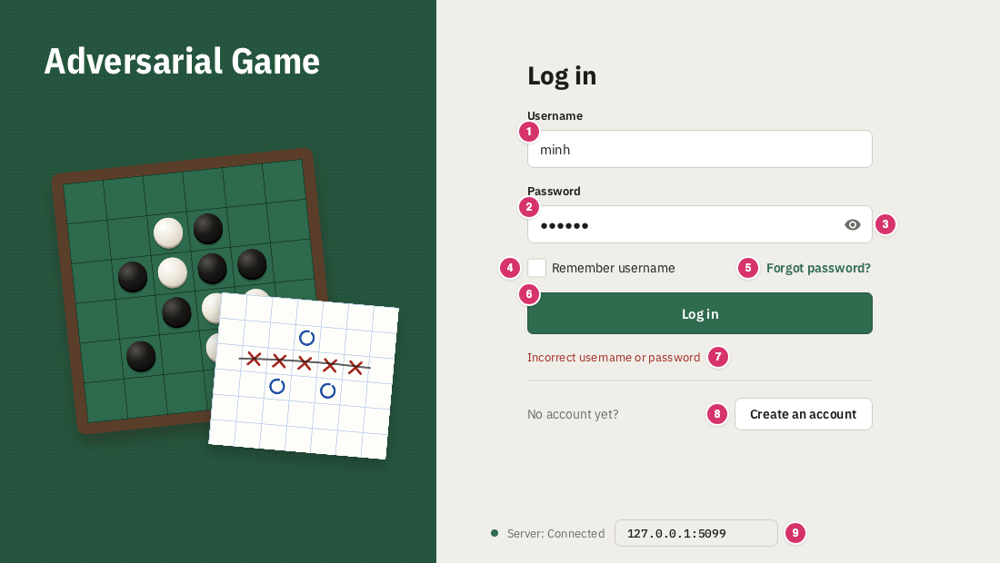

| # | Thành phần | Hành vi |
|---|---|---|
| 1 | Username | Kiểm tra trên client: 1–32 ký tự chữ, số, `_`. Điền sẵn nếu lần trước chọn ô 4 |
| 2 | Password | Kiểm tra: 1–64 ký tự in được, không dấu cách, không `\|`. Enter cũng là Log in |
| 3 | Hiện mật khẩu | Bật/tắt hiện mật khẩu |
| 4 | Remember username | Chỉ nhớ tên (Preferences), không nhớ mật khẩu |
| 5 | Forgot password? | Mở form Reset password (3.3), điền sẵn tên đang nhập |
| 6 | Log in | `LOGI\|u\|p`. `0`: sang Lobby. `1`, `2`, `11`: hiện lỗi ở ô 7 |
| 7 | Dòng trạng thái | Lỗi màu đỏ, thành công màu xanh |
| 8 | Create an account | `REGI\|u\|p`. `0\|<code>`: hộp thoại recovery code (3.2). `3`, `11`: hiện lỗi |
| 9 | Địa chỉ server | Trạng thái "Connecting…" / "Connected" / "Disconnected" kèm chấm màu. Ô `host` hoặc `host:port`, Enter để kết nối lại, địa chỉ được nhớ cho lần sau |

Thông báo kiểm tra trên client: "Enter username and password", "Username: 1-32 letters, digits or _", "Password: 1-64 characters, no spaces, no |", "Cannot connect to the server".

### 3.2 Recovery code sau khi đăng ký

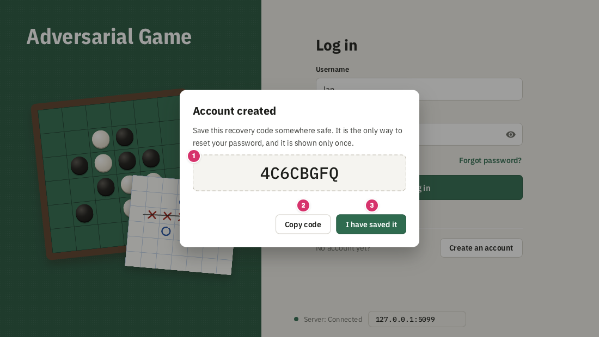

| # | Thành phần | Hành vi |
|---|---|---|
| 1 | Recovery code | Mã 8 ký tự từ `REGI\|0\|<code>`, font mono. Chỉ hiện một lần |
| 2 | Copy code | Chép mã vào clipboard, hiện "Copied to clipboard"; hộp thoại vẫn mở |
| 3 | I have saved it | Đóng hộp thoại. Dòng trạng thái: "Account created. Log in with your new password."; ô mật khẩu đã xóa |

Nếu server chưa có use case 16 (trả `REGI|0` không kèm mã), client bỏ qua hộp thoại và chỉ hiện dòng trạng thái.

### 3.3 Reset password

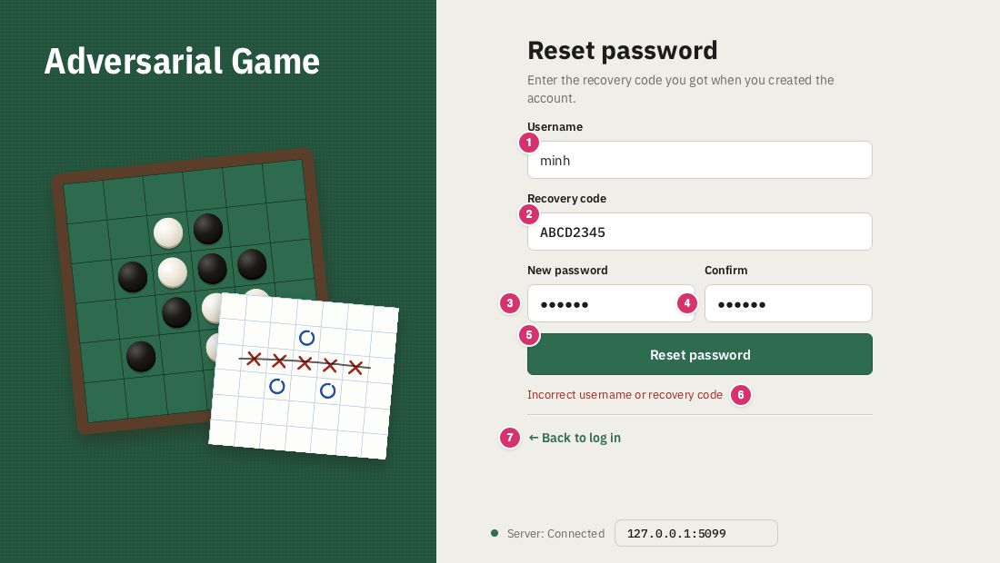

| # | Thành phần | Hành vi |
|---|---|---|
| 1 | Username | Điền sẵn từ form Log in |
| 2 | Recovery code | Client bỏ dấu cách và đổi sang chữ hoa trước khi gửi |
| 3, 4 | New password, Confirm | Kiểm tra như ô Password; hai ô phải trùng ("Passwords do not match") |
| 5 | Reset password | `RSPW\|u\|code\|new`. `0\|<code>`: hộp thoại 3.4. `17`, `11`: hiện lỗi ở ô 6 |
| 6 | Dòng trạng thái | Như ô 7 của Log in. Thông báo riêng: "Fill in all fields", "Invalid username, code or password format" |
| 7 | ← Back to log in | Quay về form Log in, không gửi gì |

### 3.4 Đổi mật khẩu thành công

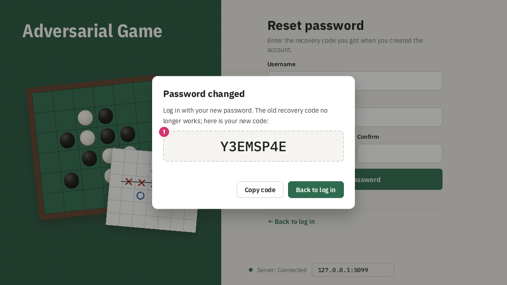

Hộp thoại "Password changed" báo mã cũ đã hết hiệu lực và hiện mã mới (1), có nút Copy code. Bấm "Back to log in" thì về form Log in, tên đã điền sẵn, dòng trạng thái: "Password changed. Log in with the new password."

---

## 4. Use case 16. Reset Password

Định nghĩa đầy đủ ở protocol.md: use case 16 trong Scenario 1, message 21 `RSPW`, mã 17, kiểu dữ liệu `<recoveryCode>`, quyết định R6. Tóm tắt:

- **Lấy mã:** ứng dụng không có email, nên server cấp cho mỗi tài khoản một recovery code 8 ký tự ngẫu nhiên khi đăng ký (`REGI|0|<code>`).
- **Đặt lại mật khẩu:** `RSPW|<user>|<code>|<newPassword>` → `RSPW|0|<newCode>`. Mã cũ hết hiệu lực, mỗi mã chỉ dùng được một lần.
- **Mã lỗi 17** dùng chung cho tên không tồn tại và mã sai, để không lộ tài khoản nào tồn tại. Tài khoản tạo trước use case 16 không có mã, nên luôn nhận 17.
- **Phiên đang đăng nhập** bằng tài khoản đó không bị ảnh hưởng.

---

## 5. Màn Lobby (use case 3–12)

Bố cục ba cột:
- **Trái:** "bàn chơi" (mặt nỉ) để chọn game và vào ván.
- **Giữa:** lời mời nhận được và người đang online.
- **Phải:** bảng xếp hạng của game đang chọn.

### 5.1 State LOBBY

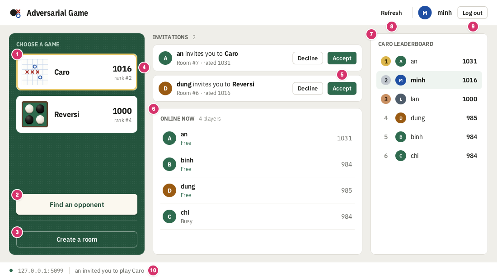

| # | Thành phần | Hành vi |
|---|---|---|
| 1 | Thẻ chọn game | Hai thẻ Caro / Reversi: bàn cờ thu nhỏ, Elo và hạng của mình ở game đó (lấy từ `RANK` của từng game). Thẻ đang chọn có viền vàng. Chỉ đổi được ở LOBBY. Game đang chọn dùng cho `RAND`, `CROM` và bảng xếp hạng |
| 2 | Find an opponent | `RAND\|<game>`. `0`: sang MATCHING (5.2) |
| 3 | Create a room | `CROM\|<game>`. `0\|<roomId>`: sang IN_ROOM (5.3) |
| 4 | Invitations | Chỉ hiện khi có lời mời. Mỗi push `INVI` thêm một dòng lên đầu: "<host> invites you to <Game>", "Room #id · rated <Elo của host>". Dòng mới sáng lên rồi nhạt dần |
| 5 | Decline / Accept | `IDEC\|<roomId>` / `IACC\|<roomId>`. `IACC\|0`: xóa hết lời mời, "Joining the game…", chờ `STRT`. `7`: xóa dòng, "This invitation is no longer valid" |
| 6 | Online now | Từ `PLST`, không hiện chính mình. Mỗi dòng: avatar chữ cái, tên, "Free"/"Busy", Elo ở game đang chọn. Free xếp trước, rồi theo tên |
| 7 | Leaderboard | Từ `RANK\|<game>`: hạng (1–3 có huy hiệu vàng, bạc, đồng), avatar, tên, Elo. Dòng của mình tô nổi |
| 8 | Refresh | Gửi lại `PLST` và `RANK` của cả hai game |
| 9 | Log out | `LOGU`. `0`: về Login. Chỉ bấm được ở LOBBY |
| 10 | Thanh trạng thái | Địa chỉ server và thông báo (5.5) |

**Khi nào client tự gửi lại `PLST`:**
- khi vào màn,
- khi bấm Refresh,
- khi nhận `IDCL`,
- khi nhận `INVT|5` hoặc `INVT|6`,
- khi quay về LOBBY hoặc IN_ROOM.

Client không gửi `PLST` định kỳ, để log server khi demo gọn.

**Gửi `RAND` hoặc `CROM` thành công** thì client xóa danh sách lời mời, vì server đã hủy các lời mời đó.

**"Busy" không ghi chi tiết:** `BUSY` của `PLST` gồm cả MATCHING, IN_ROOM và IN_GAME, nên client không ghi "in a game" như prototype.

### 5.2 State MATCHING

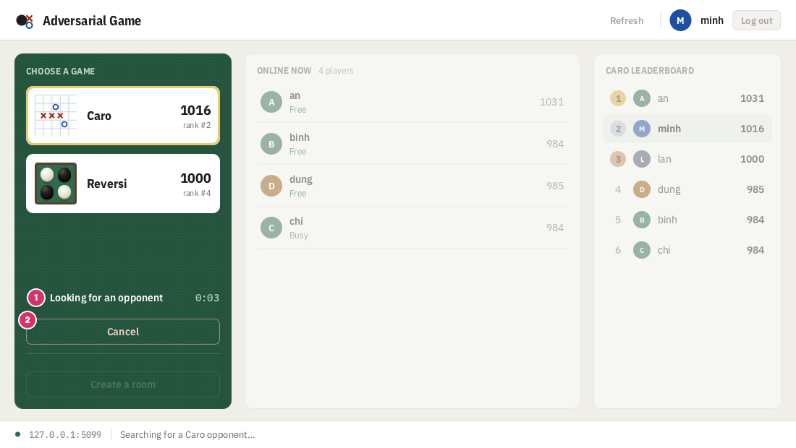

| # | Thành phần | Hành vi |
|---|---|---|
| 1 | Đang tìm | Ba chấm nhấp nháy, "Looking for an opponent", đồng hồ đếm thời gian chờ (chỉ để hiển thị, protocol không có timeout) |
| 2 | Cancel | `RCAN`. `0`: về LOBBY, "Matching cancelled". `12`: im lặng, chờ `STRT` |

Mọi phần khác bị làm mờ và không bấm được. `PLST` và `RANK` không hợp lệ ở MATCHING nên danh sách giữ dữ liệu cũ.

### 5.3 State IN_ROOM

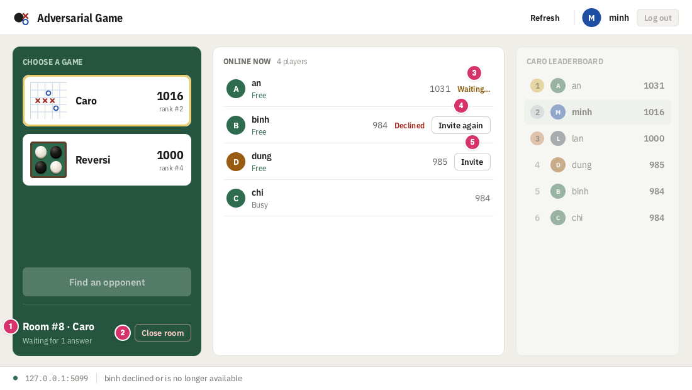

| # | Thành phần | Hành vi |
|---|---|---|
| 1 | Room #id · Game | Số phòng từ `CROM\|0\|<roomId>`; dòng dưới: "Invite a free player from the list" hoặc "Waiting for N answer(s)" |
| 2 | Close room | `DROM`. `0`: về LOBBY, "Room closed". `12`: im lặng, chờ `STRT` |
| 3 | Waiting… | Sau `INVT\|0` cho người đó |
| 4 | Declined + Invite again | Sau push `IDCL\|<user>`. Mời lại được, vì server đã xóa lời mời cũ |
| 5 | Invite | Có trên dòng của mỗi người đang Free chưa được mời. `INVT\|<user>`. Lỗi `5`, `6`, `8`, `9` hiện trên thanh trạng thái; với `5` và `6` client gửi lại `PLST` |

Ở IN_ROOM, Refresh chỉ có tác dụng với `PLST`. Bảng xếp hạng bị làm mờ vì `RANK` chỉ hợp lệ ở LOBBY. Trạng thái Waiting/Declined bị xóa khi đóng phòng hoặc vào ván.

### 5.4 Nút nào bấm được ở state nào

| Thành phần | LOBBY | MATCHING | IN_ROOM |
|---|:-:|:-:|:-:|
| Thẻ chọn game | ✓ | | |
| Find an opponent | ✓ | | |
| Cancel (matching) | | ✓ | |
| Create a room | ✓ | | |
| Invite (trên từng dòng) | | | ✓ (người Free) |
| Close room | | | ✓ |
| Accept / Decline | ✓ | | |
| Refresh | ✓ | | ✓ (chỉ `PLST`) |
| Log out | ✓ | | |

### 5.5 Thông báo trên thanh trạng thái

| Sự kiện | Kiểu | Nội dung |
|---|---|---|
| `RAND\|0` | info | Searching for a <Game> opponent… |
| `RCAN\|0` | info | Matching cancelled |
| `CROM\|0\|<id>` | ok | Room #<id> created. Invite a free player from the list |
| `INVT\|0` | info | Invited <user>, waiting for an answer |
| `INVT\|5` / `6` / `8` / `9` | error | `Code.message()` |
| push `IDCL\|<user>` | info | <user> declined or is no longer available |
| `DROM\|0` | info | Room closed |
| push `INVI` | info | <host> invited you to play <Game> |
| `IACC\|0` | info | Joining the game… |
| `IACC\|7`, `IDEC\|7` | error | This invitation is no longer valid |
| `IDEC\|0` | info | Declined the invitation from <host> |
| về từ màn Game | info | Back in the lobby. <Game> rating is now <Elo> |

---

## 6. Màn Game (use case 13–15)

Thanh trên ghi tên game và "Room #id" hoặc "Random match" (`STRT` không mang roomId, nên client tự nhớ ván vào từ phòng nào). Cột phải từ trên xuống gồm:
- thẻ đối thủ,
- thẻ của mình,
- thẻ kết quả (khi hết ván),
- danh sách nước đi,
- nút Resign.

### 6.1 Caro

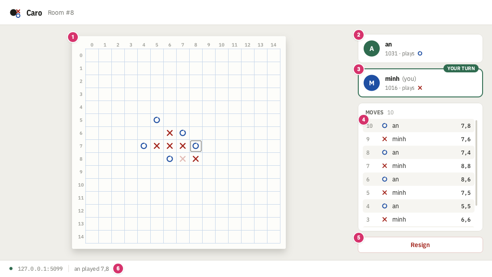

| # | Thành phần | Hành vi |
|---|---|---|
| 1 | Bàn cờ | Tờ giấy ô ly 15×15. Tọa độ hàng và cột đánh từ 0, giống `MOVE\|<x>,<y>` (x = hàng, y = cột), để đối chiếu được với log server khi demo. Nước vừa đi có khung mảnh. Khi đến lượt mình, ô dưới con trỏ hiện quân mờ (ô 8,7 trong ảnh). Click gửi `MOVE\|x,y` |
| 2 | Thẻ đối thủ | Avatar, tên, Elo, quân. Nhãn "THINKING" khi đến lượt đối thủ |
| 3 | Thẻ của mình | Như thẻ đối thủ, kèm "(you)". Viền xanh và nhãn "YOUR TURN" khi đến lượt mình |
| 4 | Moves | Mới nhất ở trên: số thứ tự, quân, người đi, tọa độ |
| 5 | Resign | Mở hộp xác nhận (6.3) |
| 6 | Thanh trạng thái | "You played x,y", "<opponent> played x,y"; lỗi `MOVE\|13`–`16` (người chơi vẫn giữ lượt) |

Khi bấm vào ô đã có quân hoặc ô không hợp lệ, client **vẫn gửi** `MOVE` để server quyết định, rồi hiện lý do theo mã 15 hoặc 16.

### 6.2 Reversi

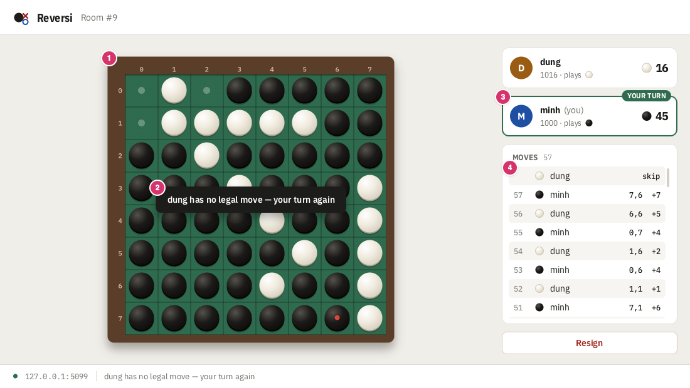

Ảnh là một ván thật được phát lại: sau nước 57 của Đen, Trắng hết nước đi nên server gửi `SKIP|2` và Đen đi tiếp.

| # | Thành phần | Hành vi |
|---|---|---|
| 1 | Bàn cờ | Bàn nỉ 8×8 viền gỗ, có tọa độ. Quân vừa đặt rơi xuống, quân bị lật xoay lại. Chấm đỏ ở nước vừa đi. Khi đến lượt mình, ô đi được có chấm mờ; client tự tính để gợi ý, server vẫn là bên quyết định |
| 2 | Nhãn nổi khi mất lượt | Push `SKIP\|<side>`: "<opponent> has no legal move — your turn again" hoặc "You have no legal move — <opponent> moves again", hiện khoảng 2,5 giây; thanh trạng thái ghi cùng nội dung |
| 3 | Số quân | Trên thẻ mỗi người, cập nhật sau mỗi `MOVE\|0` và `OPPM` |
| 4 | Moves | Thêm số quân bị lật (`+7`); lượt bị bỏ qua ghi "skip" |

### 6.3 Xác nhận đầu hàng

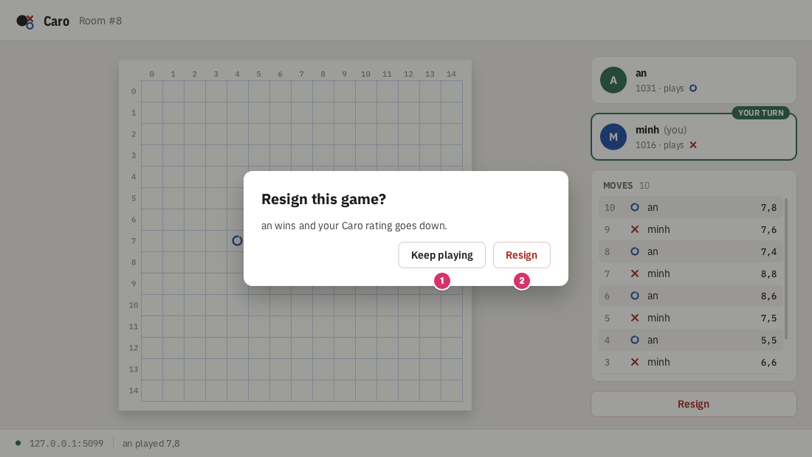

| # | Thành phần | Hành vi |
|---|---|---|
| 1 | Keep playing | Đóng hộp thoại, không gửi gì (Esc cũng vậy) |
| 2 | Resign | Gửi `RSGN`, tắt nút Resign. `0`: chờ `OVER`. `12`: im lặng |

Nếu `OVER` đến khi hộp thoại đang mở, hộp thoại tự đóng.

**Đóng cửa sổ giữa ván** cũng hỏi: "Quit the game? Quitting now counts as a loss, and <opponent> wins." Chọn Quit thì đóng kết nối mà không gửi `RSGN`, vì ngắt kết nối cũng bị tính thua (protocol.md mục 12).

### 6.4 Kết thúc ván

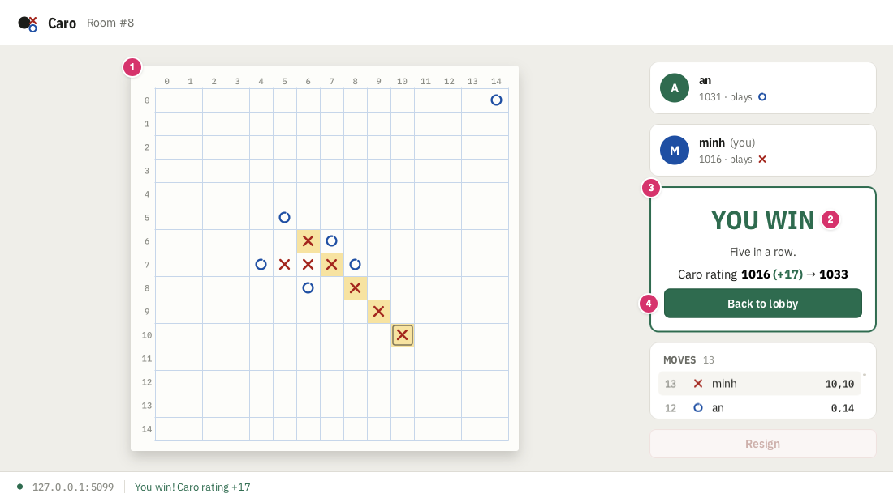

| # | Thành phần | Hành vi |
|---|---|---|
| 1 | Hàng thắng (caro) | Hàng từ 5 quân trở lên đi qua nước cuối được tô vàng |
| 2 | Kết quả | "YOU WIN" (xanh), "YOU LOSE" (đỏ), "DRAW" (đen), viền thẻ cùng màu. Dòng dưới là lý do (bảng dưới) |
| 3 | Elo | "<Game> rating <cũ> (<delta>) → <mới>" từ `OVER\|<result>\|<delta>\|<newRating>`; Elo cũ = mới − delta |
| 4 | Back to lobby | Về Lobby ở LOBBY, chọn sẵn game vừa chơi |

Nút Resign bị tắt và bàn cờ không nhận click nữa.

`OVER` không gửi lý do kết thúc, nên client tự suy ra từ bàn cờ:

| Tình huống | Lý do hiển thị |
|---|---|
| Caro, có hàng 5 qua nước cuối | "Five in a row." / "<opponent> made five in a row." |
| Reversi, cả hai hết nước đi | "No moves left: <của mình> to <đối thủ>." |
| DRAW khác | "The board is full." |
| Mình vừa đầu hàng | "You resigned." |
| WIN khác | "<opponent> resigned or left the game." |

---

## 7. Mất kết nối

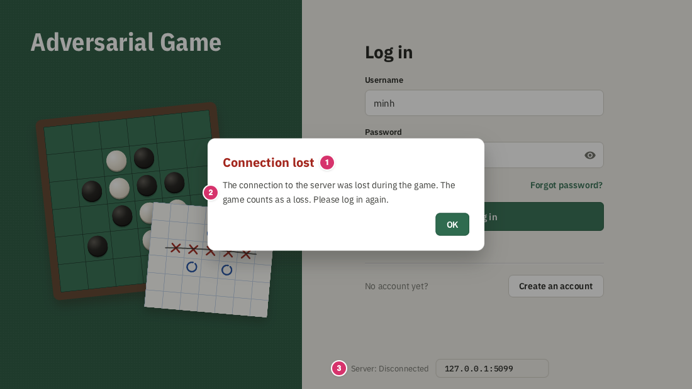

Khi kết nối bị đóng mà không phải do mình ngắt, client về màn Login và hiện hộp thoại.

| # | Thành phần | Hành vi |
|---|---|---|
| 1 | Connection lost | Tiêu đề màu đỏ |
| 2 | Nội dung | Đang trong ván: "The connection to the server was lost during the game. The game counts as a loss. Please log in again." Ở chỗ khác: "The connection to the server was lost. Please log in again." |
| 3 | Server | "Server: Disconnected", chấm đỏ. Tên đăng nhập được giữ lại |

Client không tự kết nối lại: protocol không có reconnection vào ván đang chơi. Bấm Log in sẽ kết nối lại.

---

## 8. Các điểm đã chốt

Nhóm chốt theo prototype ngày 19/11/2026:

| # | Câu hỏi | Đã chốt |
|---|---|---|
| D1 | Ngôn ngữ giao diện | Tiếng Anh |
| D2 | Quên mật khẩu | Có, bằng recovery code (use case 16, protocol.md R6) |
| D3 | Tự làm mới danh sách người chơi | Chỉ khi có sự kiện (5.1), không gửi `PLST` định kỳ |
| D4 | Quân caro | ✕ / ◯ nét bút |
| D5 | Tọa độ bàn cờ | Đánh từ 0 như protocol |
| D6 | Gợi ý nước đi reversi | Bật |
| D7 | Ô Confirm password khi đăng ký | Không; Login và Register dùng chung một form |
| D9 | Theme cũ và ảnh `bg_login.png` | Bỏ, thay bằng theme mục 1.2 |

---

## 9. Ngoài phạm vi

Không làm vì cần thêm message hoặc không thuộc yêu cầu môn:
- chat,
- xem lại ván cũ,
- đổi mật khẩu khi đang đăng nhập,
- avatar ảnh,
- giới hạn thời gian mỗi nước,
- âm thanh,
- kết nối lại vào ván đang chơi,
- đổi kích thước bàn cờ hoặc kích thước cửa sổ.

---

## 10. Mã nguồn và ảnh chụp

| File | Nội dung |
|---|---|
| `ui/theme.css`, `ui/Theme.java` | Bảng màu, font, mặt nỉ |
| `ui/fonts/` | IBM Plex (`.ttf`) và giấy phép `OFL.txt` |
| `ui/Widgets.java`, `ui/Pen.java` | Avatar, logo, icon quân; nét bút ✕ / ◯ và quân reversi có khối |
| `ui/Dialogs.java` | Hộp thoại trong cửa sổ |
| `ui/LoginArt.java` | Panel trái màn Login |
| `ui/board/BoardView.java` | Bàn cờ: hai lớp canvas, tọa độ, quân mờ, gợi ý, hàng thắng, hiệu ứng |
| `login-view.fxml`, `LoginController.java` | Mục 3 |
| `lobby-view.fxml`, `LobbyController.java` | Mục 5 |
| `game-view.fxml`, `GameController.java` | Mục 6 |
| `app/game/GameSession.java` | Bàn cờ phía client, lịch sử nước đi, luật để hiển thị (nước đi hợp lệ, hàng 5) |
| `App.java`, `SceneManager.java` | Cửa sổ cố định, xác nhận khi đóng giữa ván, mất kết nối |

(Đường dẫn tính từ `client/src/main/java/netpro/client/` và `client/src/main/resources/netpro/client/`.)

**Chụp lại ảnh:** `sh docs/ui-spec/capture/capture.sh` (macOS, khoảng một phút, cần server đã build ở `server/build`, Java 21+, Python 3 và Google Chrome). Script dùng cổng 5099 và kho tài khoản tạm, không đụng tới `users.db` thật, địa chỉ server và tên đăng nhập đã lưu. [Capture.java](ui-spec/capture/Capture.java) điều khiển client và bot; [overlay.py](ui-spec/capture/overlay.py) vẽ số chú thích (vị trí lấy từ chính các thành phần trên màn hình).

Prototype bấm thử được: https://claude.ai/artifact/KJorrHMBvkxyE8GdHLLRAR (riêng tư cho tới khi chia sẻ).
